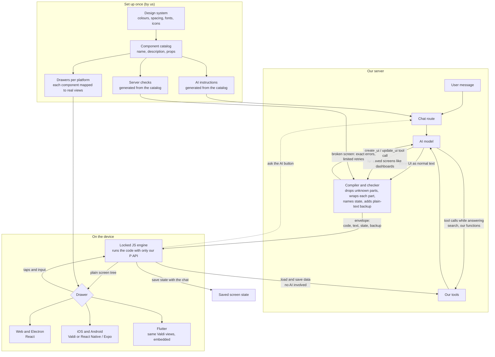
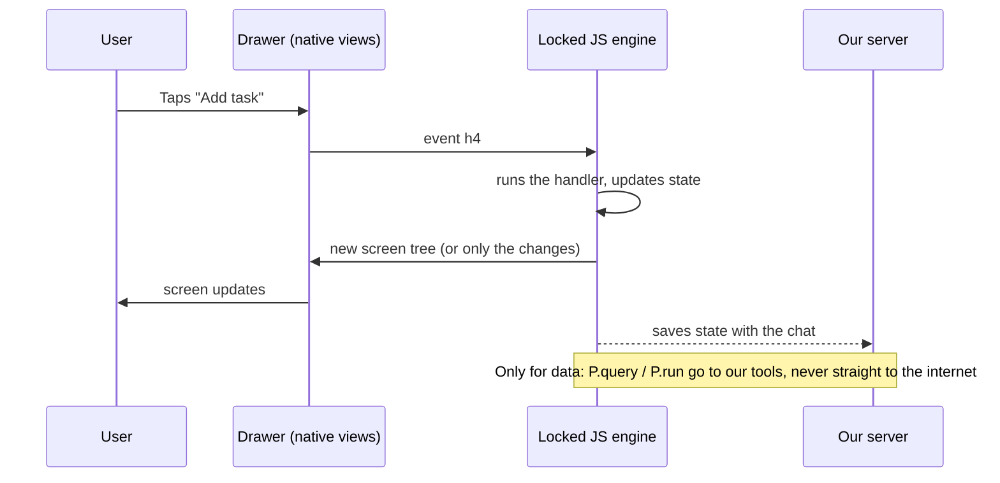

# Prism: how it will work

We build it step by step (see section 8). The exact format at each step is in `FORMAT.md`. The parts, values and tokens are in `DESIGN-SYSTEM.md`.

**In one line:** the AI writes a short UI block in JSX style. Our server checks it and compiles it. Each device runs it in a locked JavaScript engine and draws it with its own native views.

**Final design (2026-10-21), section 9:** small, stable SDK on the phone; the parts and the design live in a part library that comes from the server. New parts and design fixes ship without app updates.

---

## 1. The big picture



---

## 2. Three ways UI and data move

| Path | When | How |
|---|---|---|
| **Inline UI** | UI inside a normal chat reply | The AI writes a ` ```prism ` block in its streamed text |
| **Saved screen** | Dashboards and screens the user reopens and edits | The AI calls our `create_ui` / `update_ui` tool |
| **Screen data** | Loading or saving data from a screen | The screen calls our tools directly, without the AI |

---

## 3. What a tap does



---

## 4. The message at each step

**1. The AI writes** Markdown with a UI block:

````markdown
Here's your task tracker:

```prism
const [tasks, setTasks] = useState([{ title: "Design", done: true }, { title: "Build", done: false }])

<Card title="Tasks">
  {tasks.map((t, i) => (
    <Row key={i}>
      <Checkbox value={t.done} />
      <Text strike={t.done}>{t.title}</Text>
    </Row>
  ))}
  <Button onPress={() => setTasks([...tasks, { title: "New", done: false }])}>Add</Button>
</Card>
```
````

**2. The server sends** a checked envelope:

```json
{
  "v": 1,
  "id": "msg_123/block_0",
  "ok": true,
  "code": "P.screen(function (S, T) { const tasks = S.tasks; ... return P.el(\"Card\", \"n0\", null, [...]); })",
  "text": ["Add", "Tasks"],
  "state": { "tasks": [{ "title": "Design", "done": true }, { "title": "Build", "done": false }] },
  "uses": ["Button", "Card", "Checkbox", "Row", "Text"],
  "spec": { "Button": { "c": "text", "p": { "variant": { "t": "enum", "e": ["solid", "outline", "ghost"], "d": "solid" } } } },
  "fallback": "**Tasks**\n- [x] Design\n- [ ] Build",
  "diagnostics": []
}
```

`spec` (shortened here) carries the catalog rules for each part used, so the device can check every prop and fill in the defaults.

**3. The engine outputs** a plain screen tree for the drawer:

```json
{ "t": "Card", "id": "n0", "p": { "title": "Tasks", "gap": "md", "pad": "lg" }, "c": [
  { "t": "Row", "id": "n1", "k": 0, "p": { "gap": "sm", "pad": "none", "align": "center", "justify": "start", "wrap": false }, "c": [
    { "t": "Checkbox", "id": "n2", "p": { "value": true, "disabled": false } },
    { "t": "Text", "id": "n3", "p": { "strike": true, "size": "md", "tone": "neutral", "weight": "regular", "align": "start" }, "c": ["Design"] }
  ]},
  { "t": "Row", "id": "n1", "k": 1, ... "Build" ... },
  { "t": "Button", "id": "n4", "p": { "variant": "solid", "tone": "primary", "size": "md", "disabled": false }, "c": ["Add"], "on": { "press": "h0" } }
]}
```

Every prop is filled in: the drawer never guesses a default.

---

## 5. Platforms

| Platform | Where the JS runs | What draws it |
|---|---|---|
| Web | Hidden locked iframe or worker | React, directly in the page |
| Electron | Same as web | Same React drawer |
| iOS / Android | Inside Valdi: Apple's built-in JavaScriptCore on iOS, bundled QuickJS on Android | Valdi native views |
| Flutter | Valdi's engine | Valdi views embedded in Flutter (Flutter widgets only if this fails a test) |
| Raw HTML from the AI | Visible locked iframe on every platform | The browser engine |

---

## 6. Safety rules

- AI code only sees our frozen `P` API: no internet, no files, no device access.
- Every run has a time limit, so a bad loop can't freeze the app.
- Only images and links the server approved are shown.
- Each part of the screen can fail on its own without breaking the rest.
- On Electron, AI code never runs with access to the computer.

---

## 7. Which AI model

Tested so far with **Claude Haiku 5.5** (`claude-haiku-5-5`), given only `core/dist/prompt.md`: 40 of 40 replies compiled clean (see `core/eval/`).

| Model | ID | Price per 1M tokens (in / out) | Use |
|---|---|---|---|
| Claude Haiku 5.5 | `claude-haiku-5-5` | $0.10 / $0.50 | Default for screens |
| Claude Sonnet 5.5 | `claude-sonnet-5-5` | $2 / $10 | If Haiku struggles with complex screens |

A reply costs about 3,000 prompt tokens and 600 output tokens: roughly $0.0006 with Haiku. The prompt is above Haiku's 512-token caching minimum, so keep it byte-for-byte the same at the start of the system prompt and cache it.

---

## 8. Build plan

We build in small steps. Each step ends with something we can see working.

**Done (in `core`):**

1. Format and compiler: JSX with React `useState` → checked, plain JavaScript (`FORMAT.md`).
2. Runtime: the same file on every platform; draws a complete, checked tree.
3. Design system: one catalog for parts, values and tokens; the AI instructions and token files are generated from it (`DESIGN-SYSTEM.md`).
4. AI test: 20 requests, run through separate agents; replies kept as regression tests (`core/eval/`).

**Next:**

| Step | What | Done when |
|---|---|---|
| 1 | **Web drawer** on the new design system | The examples and the AI test replies look right in the browser, light and dark |
| 2 | **iOS drawer** (Valdi): tokens from `tokens.json`, icons as SF Symbols, native Select | The same screens on the iPhone simulator |
| 3 | **Android drawer** (Valdi): Material icons, native Select | The same screens on the Android emulator |
| 4 | **Chat loop**: a model reply goes through `compileMessage` and shows in the chat | One real conversation working end to end on web |
| 5 | **`Chart` and `Image` parts** (`core/COMPILER-PLAN.md`) — done 2026-10-20 | The steps chart from the AI test draws as a real chart; a product photo shows only from server-approved addresses (`appData`) |

**Frozen for v1:** the 24 parts, `useState` only, no tool calls from screens.

**Parked for later:** `Link` (same `appData` idea as `Image`), a `Timer` part, `P.query` / `P.run`, drawing while streaming, saved screens (`create_ui` / `update_ui`), small edits instead of full rewrites, Flutter and Electron polish, `useMemo` / `useCallback`.

---

## 9. Final design: small SDK, smart server (decided 2026-10-21)

**Why:** an SDK update travels slowly: we release it, each company ships a new app version, each user installs it. If the parts lived in the SDK, a new part or a design fix would take months to reach people. So the SDK only knows a few **basic blocks**; everything that changes often lives in a **part library** that comes from the company's server.

```
AI (any model)            company's server (@prism/server)           phone (Prism SDK)
──────────────            ────────────────────────────────           ─────────────────
writes rich parts   ──▶   checks: only parts on the list;      ──▶   safe box runs the screen code
<Carousel> <Quiz>         compiles; says "library 1.4"               + part library 1.4 (cached; a copy
<Stat> <FollowUps>                                                     ships inside the SDK)
no colours, no sizes                                                  parts → basic blocks with roles
                                                                      drawn natively with the app's theme
```

### Who owns what

| Piece | Lives in | Changes how often | How it ships |
|---|---|---|---|
| **Basic blocks:** box, row, text, image, button, slider, switch, input, select, checkbox, **pager** (swipe sideways), **collapse** (open/close), chart; later date picker | the SDK | rarely | app update |
| **Part library:** Card, Stat, Callout, Steps, Tabs/Choice, Quiz, FollowUps, Compare, Carousel, Timeline… built from basic blocks | `@prism/server`, sent to phones and cached | often | server deploy (by the company) |
| **Theme:** the app's colours, font, corners | the app or its server (a theme file) | when the brand changes | app or server |
| **Light/dark, text size, accessibility** | the phone | — | — |

Rule of thumb: a part that needs a special **movement or input** (swiping, opening, a calendar) gets a native block in the SDK. A part that is only **arrangement and style** lives in the library.

### One example

The AI writes (only parts on its list):
```jsx
<Quiz question="What is a token?" options={["A sentence", "A small piece of text", "A password"]} answer={1}
      explain="LLMs split text into small pieces called tokens." />
```
The part library (on the phone, from the server) turns it into basic blocks with roles, never colour codes:
```jsx
<box style="card">
  <text role="title">What is a token?</text>
  <button role="choice" selected={picked === 1}>A small piece of text</button> …
  {picked !== null && <box style="note" status={picked === 1 ? "good" : "bad"}>…</box>}
</box>
```
The SDK draws `card`, `title`, `good` with the app's theme. Next week a new `Timeline` part ships in library 1.5: every app shows it, even old versions, without an app store update.

### Rules that make it safe

1. **The AI only writes parts on its list, never basic blocks** (the compiler blocks them), so it can't style anything.
2. **The library ships inside the company's server package, versioned.** The company decides when to update; we never push code into their apps.
3. **Basic blocks use colour roles and accessibility roles** (heading, list, button, choice), never colour codes.
4. **Heavy things stay native blocks:** pager, collapse, chart, date picker.
5. **An agreement between the two halves:** the SDK says which basic-blocks version it understands; each library says which it needs; the server only sends what the app can draw.
6. **A library copy inside the SDK,** so the first screen and offline screens never wait for a download.
7. **Screenshot tests on iOS, Android and web before every library release**, and a debug view that shows the blocks behind any screen.
8. **Non-JavaScript servers** (Python, Go, Java) get a ready-made small program or a hosted option for the compiler.

### Build order

1. Basic blocks in the SDK (Valdi drawer) and the web drawer. **Done 2026-10-21:** 15 blocks in `catalog.json` (`blocks`), checked by the runtime (`prism.setBlocks`, added to `dist/prism-runtime.js` by the build), drawn on web, iOS and Android; the AI can't write them (`compile(..., { blocks: true })` only for our own code); example `11-blocks`. Known: Android's Material slider still uses Material's own track colour (fix with the theme in step 3).
2. Part library in JavaScript, run in the safe box; versioned; a copy inside the SDK. **Done 2026-10-21:** `core/library/prism-library.js` (1.0.0) builds `Steps`, `Step`, `Choice`, `Field`, `Quiz`, `FollowUps` and `Carousel` from blocks, with each part's own state kept in snapshots; `prism.setLibrary(code)`; the build puts a copy in `dist/prism-runtime.js`; the server serves `GET /library`; apps set `Prism.library` (iOS, Android). Proven on the iPhone: a library change on the server changed the drawing without rebuilding the app. Existing parts (Card, Stat…) move into the library in step 3, when their inputs change.
3. The design system on top (`DESIGN-SYSTEM.md`): meaning-only parts, chat parts, theme from the app. **Done 2026-10-21:** every part is built by the part library (1.1.0); the AI's inputs are meaning only (old ones kept as hidden legacy); the library owns the calm rules; the AI instructions teach the chat parts with example screens; `Prism.theme` (iOS, Android) and a web picker turn one brand colour into readable accent colours for light and dark. Left: `Compare`, the app's text size and font, corners, one W3C token source (DESIGN-SYSTEM.md section 11).
4. Streaming: the screen grows while the AI writes. **Done 2026-10-21:** `core/compiler/partial.js` closes what's still open in a half-written block; the server sends `block_partial` (at most every 250 ms); the web and iOS chats grow the same widget in place; the SDK keeps the old drawing until the new one is ready, so nothing flashes.

