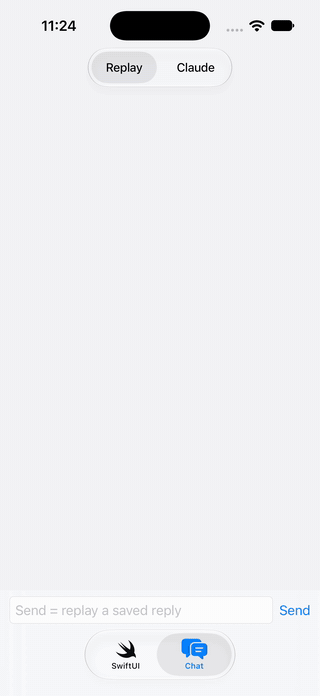
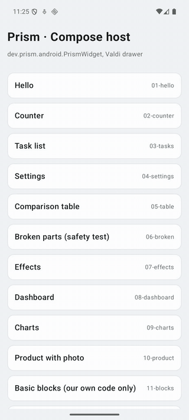

# Prism

**Let any AI model show small interactive screens inside a chat, drawn with real native views on iOS, Android and the web.**

You ask "split a ₹2,400 dinner between 3 people, I'll tip 10%". Instead of only text, the answer contains a working calculator with sliders. On an iPhone it is made of real iOS views, on Android real Android views, on the web real HTML. It follows the app's brand colour, light and dark mode, and the phone's text size.

> **Status: 0.1 open preview.** It works end to end, but things can still change. Read [Not done yet](#not-done-yet) before you build on it.

| iOS: a reply streams in, then the screen is used | Android: the chat parts, drawn with Android views |
|---|---|
|  |  |

## How it works

```
your server                                   Prism
───────────                                   ─────
system prompt + Prism's instructions
your model (Claude, GPT, Gemini, local…)
  └─ calls the show_screen tool  ─────────▶  compiler: checks the code, fixes small slips,
                                              blocks anything unsafe, packs one JSON "envelope"
send the envelope to the app     ◀─────────
                                              runtime + part library (inside the app):
                                              runs the screen, keeps its values, handles taps
                                              native drawer: draws it with real views
```

- **Prism never calls a model and needs no API key.** It is a tool you hand to the model you already use.
- **The AI only picks parts and meaning, never colours or sizes.** It writes `<Button main>`, `<Quiz>`, `<Stat status="good">`. How those look comes from the design tokens and your brand settings.
- **The AI's code runs in a sandbox.** No network, no device access, endless loops are stopped, and one broken part only hides that part.

What the model writes, as the `code` of a `show_screen` call:

```jsx
const [bill, setBill] = useState(2400)
const [people, setPeople] = useState(3)
const each = Math.round(bill * 1.1 / people)

<Card title="Split the bill">
  <Slider label="Bill (₹)" value={bill} min={100} max={10000} step={100} onChange={setBill} />
  <Slider label="People" value={people} min={1} max={10} onChange={setPeople} />
  <Stat label="Each person pays" value={"₹" + each} />
</Card>
```

## Install

Once 0.1.0 is released (until then, build from source as below):

| Where | How |
|---|---|
| Server (Node 18+) | `npm install prism-genui` |
| iOS (Swift Package Manager) | `.package(url: "https://github.com/RunTerror/prism", from: "0.1.0")`, product `Prism` |
| Android (Gradle) | `implementation("io.github.runterror:prism-android:0.1.0")` |

## Quick start

### 1. Try the engine (2 minutes, no AI needed)

Needs Node 18+.

```sh
cd poc/core
npm install
npm test            # 90 tests
npm run build       # writes dist/: runtime, AI instructions, design tokens
```

Then see every example screen in the browser:

```sh
cd ../web && npm install && npm run dev
```

### 2. Use it with your model

On your server, add Prism's instructions and its tool, then pass each tool call to Prism. With the Anthropic SDK:

```js
import Anthropic from "@anthropic-ai/sdk";
import { prismTool, toolPrompt, handleToolCall } from "prism-genui/tool";

const client = new Anthropic();
const reply = await client.messages.create({
  model: "claude-sonnet-5-5",
  max_tokens: 4000,
  system: "You are a helpful assistant.\n\n" + toolPrompt(),
  tools: [prismTool("anthropic")],
  messages,
});

for (const block of reply.content) {
  if (block.type !== "tool_use" || block.name !== "show_screen") continue;
  const { envelope, result } = handleToolCall(block.input, { id: block.id });
  if (envelope?.ok) sendToApp(envelope);          // your own channel to the app
  // Give `result` back to the model as the tool_result: "Shown to the user." or what to fix.
}
```

With OpenAI-style APIs, use `prismTool("openai")` and pass `tool_call.function.arguments` (a JSON string) to `handleToolCall` as is. For MCP clients, `prismTool("mcp")` gives the MCP shape, and `poc/core/scripts/mcp-server.mjs` is a small working MCP server.

**Streaming.** While the model is still writing the call, `partialToolCode(argumentsSoFar)` gives the code so far, and `partialEnvelope()` in `prism-genui/partial` turns it into a screen that already works. The screen fills in as the model writes.

**No tool support?** Use `dist/prompt.md` instead of `toolPrompt()`. The model then writes ```` ```prism ```` blocks inside its normal reply, and `compileMessage(reply)` splits the reply into text and envelopes.

### 3. Show it in the app

**iOS** (SwiftUI; `PrismWidgetView` for UIKit):

```swift
import Prism

PrismWidget(envelopeJSON: envelope, instanceId: "msg_1/block_0",
            onEffect: { effect in /* toast, open a link, copy, or ask the AI */ })
```

**Android** (Compose; `PrismWidgetView` for Views):

```kotlin
PrismWidget(envelopeJson = envelope, instanceId = "msg_1/block_0",
            onEffect = { effect -> /* toast, open a link, copy, or ask the AI */ })
```

**Web**: the React drawer in `poc/web`.

The widget fills the width it gets and sizes its height to its content. To keep a screen exactly as the user left it (in a scrolling chat, or when a chat is reopened), save the `onSnapshot` value and pass it back as `snapshot`. See [`poc/sdk/README.md`](poc/sdk/README.md).

**Your brand:** set `Prism.theme` once with your accent colour, corner style (rounded, square or pill) and fonts. Every screen follows it.

### 4. Run the demo apps

The iOS and Android demo apps show every example screen and a chat. The chat has two modes:

- **Replay** plays real AI answers that were saved earlier. It needs no AI and no account.
- **Claude** sends your message to a live model. Today this uses the Claude Code app on the developer's Mac (`node poc/server/server.mjs`), so it only works where Claude Code is installed and signed in.

Building the mobile SDK from source takes about 25 minutes the first time and needs Valdi's toolchain (Bazel). See [`poc/sdk/README.md`](poc/sdk/README.md). Ready-made packages are coming; see below.

## What the AI can use

24 parts, chosen for answers in a chat:

| Group | Parts |
|---|---|
| Chat | `Steps`, `Step`, `Choice`, `Field`, `Quiz`, `FollowUps`, `Compare`, `Carousel` |
| Layout | `Stack`, `Row`, `Card`, `Divider` |
| Content | `Title`, `Text`, `Badge`, `Callout`, `Stat`, `Progress`, `Chart` |
| Controls | `Button`, `Switch`, `Input`, `Slider`, `Select` |

The full list with every setting is in [`poc/core/catalog.json`](poc/core/catalog.json). Why the list is this short is explained in [`DESIGN-SYSTEM.md`](DESIGN-SYSTEM.md).

**How well models use it:** with Claude Haiku on 20 test requests (`poc/core/eval`), 16 to 19 answers per run drew with no fixes needed, and the rest were fixed by the compiler. Other models are not measured yet.

## Not done yet

Honest list of what is missing or rough in 0.1:

**Packages and setup**
- **No published packages yet.** The iOS, Android and npm packages are prepared (see Install) but not released. Today you build from source.
- **Building the mobile SDK is slow and heavy:** about 25 minutes and Valdi's toolchain.
- **The demo chat's live mode depends on Claude Code** on the developer's machine. Your own app uses the tool call above instead.

**What screens can do**
- **Screens can only ask the app for four things:** show a message, open a link, copy text, or send a chat message. Custom app actions (like "add to cart") are not built yet.
- **Screens can't get the app's own data** (like a user's orders) except images the server approves.
- **Only `useState`.** No timers, network calls or other React hooks, on purpose, for safety. A countdown timer is not possible yet.
- **No icons.** They come back with a chosen icon set.
- **Your app can't add its own native parts yet.**

**Quality**
- **Accessibility:** text follows the phone's text size, but screen readers are not fully tested. Some buttons are not announced as buttons on iOS.
- **Only measured with Claude Haiku.** GPT, Gemini and local models should work through the tool, but their success rate is unknown.
- **The version check is new.** An app tells the server which parts it can draw, and the AI only gets those (see [`VERSIONS.md`](VERSIONS.md)). It has only been tried with the demo apps.

**Platforms and size**
- **Platforms:** iOS 15+, Android 7+ (API 24), web (React). Flutter has an early plugin. React Native is not started.
- **App size:** about +5 MB download on iOS and +7 MB on Android.

**Demo apps**
- **The Android demo has no chat tab yet** (iOS has one), and no automatic UI tests: Android is checked by hand.

See [`ROADMAP.md`](ROADMAP.md) for the plan.

## Repository

| Folder | What it is |
|---|---|
| `poc/core` | The engine: catalog, compiler, runtime, part library, tool helpers, tests |
| `poc/sdk` | The mobile SDK (Valdi): iOS and Android packages, Flutter plugin, demo apps |
| `poc/web` | React drawer, example gallery and playground |
| `poc/electron` | The web app in a desktop window |
| `poc/server` | Development chat server for the demo apps |
| `ARCHITECTURE.md`, `FORMAT.md`, `DESIGN-SYSTEM.md` | How it is built, the message format, the design system |

## License

Apache 2.0, see [LICENSE](LICENSE). The mobile packages include [Valdi](https://github.com/Snapchat/Valdi) by Snap Inc. (MIT), see [NOTICE](NOTICE).
