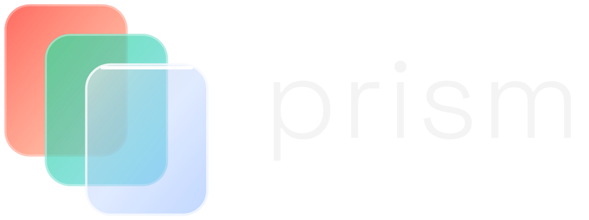

# Prism brand

**The mark:** three panes of glass, one behind the other: one idea becoming many screens (iOS, Android, web). Coral at the back, mint in the middle, azure glass in front.

## Files

| File | Use it for |
|---|---|
| `prism-logo-dark.svg` | the full logo (mark + wordmark) on **dark** backgrounds |
| `prism-logo-light.svg` | the full logo on **light** backgrounds |
| `prism-mark-dark.svg` / `prism-mark-light.svg` | the mark alone, where the name is already shown |
| `prism-app-icon.svg` | app icons: the mark on a dark glass tile |
| `favicon.svg` | browser tabs and anything 32 px or smaller: solid panes, no glass effects |
| `png/` | ready-made PNGs: app icon 1024 / 512 / 180, favicon 32 / 16, mark 512, logo 1200 |

The wordmark is already turned into shapes, so the files look the same everywhere without the font installed.

## Colours

| | Dark background | Light background |
|---|---|---|
| Back pane | coral `#FF5A4E` → peach `#FFB38A` | `#E5483C` |
| Middle pane | mint `#3DDC97` → aqua `#3CC8E0` | `#1FA971` |
| Front pane | off-white `#E7E5E4` → azure `#4C8DFF` | `#3A76F0` |
| Background | near-black `#050506` | white |
| Wordmark | `#F4F4F5` | `#18181B` |

## Font

The wordmark is **Space Grotesk Light** (weight 300), letter-spacing 0.03 em, all lower case. Space Grotesk is by Florian Karsten, free under the SIL Open Font License ([Google Fonts](https://fonts.google.com/specimen/Space+Grotesk)). Use it for headings that sit next to the logo too.

## Please don't

- add a light beam or a rainbow to the mark (it starts to look like a famous album cover);
- recolour the panes, change their order, or stretch the mark;
- use the dark-background files on white (the front pane disappears): use the `-light` files;
- shrink the full logo below 120 px wide: use the mark alone.

These files come from logo direction 27, "Panes, refined glass", on the logo design canvas.
